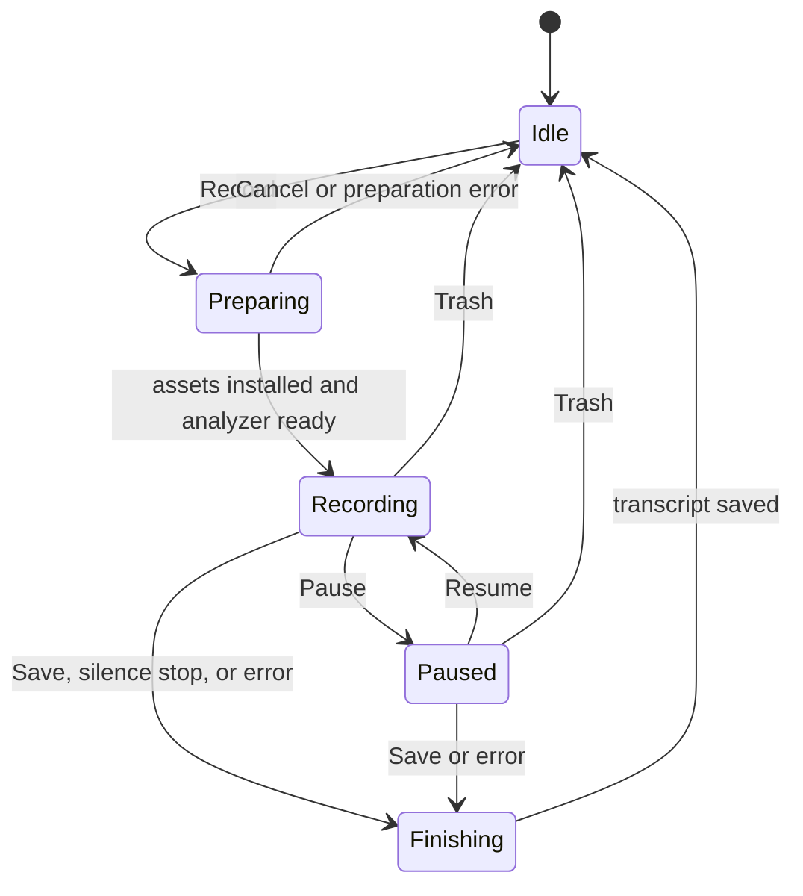
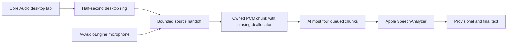

# Apple streaming implementation

Implemented on 2 November 2026 after the [model investigation](transcription-performance.md).
The requirement is live text with no saved audio and prompt disposal of consumed PCM.
The selected language is fixed for each recording. Automatic switching was deferred
because the tested multilingual streaming alternative depended on replay recovery for
better accuracy and retained raw audio longer than the intended design allows.

## Product behavior

This document covers the Apple engine. Nemotron and Parakeet are selectable alternatives,
and the debug drawer and `debug.json` are described with them in
[live-engines.md](live-engines.md). The language picker below applies only to Apple.

- Apple streaming handles live recognition in all three audio-handling modes.
- Transcript-only is the default for new installations. Persisted recording modes are
  preserved, so existing users must select transcript-only if they previously kept audio.
- The panel and Settings expose German, English, French, Spanish and Italian. The
  recognizer resolves the selected locale against Apple's supported locales before
  capture. An unavailable locale or preparation failure prevents recording from starting.
- Existing `de`, `en`, etc. preferences migrate to explicit locales. A previous `auto`
  choice resolves from the system language, with English as the fallback. There is no
  Auto entry and no hidden per-window detection.
- The minimum OS is now macOS 26 in both the package and app bundle. macOS 15 support
  was deliberately removed when adopting the native API.
- Whisper and SpeakerKit remain for retained files. Live capture does not preload or
  download a Whisper model. Selecting the polish mode explicitly permits retaining audio.

## Session lifecycle

Preparation runs before session-folder creation and before microphone or desktop
capture starts. The user can cancel preparation without opening the capture devices; macOS may
continue an asset download it already owns. A canceled preparation task cannot later start capture or cancel
a replacement session. Each native session also carries a generation identifier so
late results from canceled work cannot update a new transcript.

Pause gates both capture feeds; the remaining submitted tail can still be recognized.
The native input timeline counts submitted samples, so pauses are omitted from its
timestamps. The elapsed UI timer retains its previous wall-time behavior. Sample times
are represented as integer frame positions with the native sample rate as the CMTime
timebase. Converting seconds to an arbitrary timebase caused adjacent buffers to
appear to overlap in a real replay and was replaced.

Save first stops both captures, then drains their remaining handoff data, closes the
analyzer input stream and finalizes recognition. A ten-second finalization watchdog
requests cancellation and marks the transcript incomplete. No new recording can begin
until finalization/saving is finished; optional saved-file transcription also disables
recording until it finishes. Trash discards input immediately, cancels all recognition
tasks and removes the session folder. Existing retained audio can be downgraded to
transcript-only through the same existing close-and-delete path.

## Audio ownership

| Boundary | Bound and disposal |
| --- | --- |
| OS capture buffers | Borrowed from Core Audio / AVAudioEngine; the app does not overwrite memory it does not own. |
| Desktop ring | Half a second at the capture rate (minimum 4096 frames). Consumed slots are wiped before publishing the read index; remaining storage is wiped on destruction. Overflow is reported as a fatal capture error. |
| Capture scratch | Downmix/resampling scratch and desktop writer chunks are wiped after synchronous consumers return. The requested microphone tap size is 1024 frames; actual delivery is controlled by macOS. |
| Source handoff | Two fixed-capacity channels, each holding at most 500 ms at the analyzer's rate. Resampling scratch is wiped after ingest. Interpolation retains one previous sample per source until the next callback or reset; it is also wiped on resampler destruction. Draining moves remaining samples to the front and wipes the vacated slots. |
| Mix/submission | The main-actor pump wakes every 50 ms and emits at most 100 ms per chunk. A missing/stale source is padded after roughly 100 ms; the final drain flushes both tails. Desktop plus microphone is clipped to [-1, 1], so a silent source no longer halves the other source. |
| Analyzer input queue | `AsyncStream.bufferingOldest(4)`. Overflow or unexpected termination stops capture, rather than growing a queue or silently continuing with missing text. |
| Submitted PCM | Owned raw allocation wrapped by `AVAudioPCMBuffer(bufferListNoCopy:)`. Its deallocator calls `memset_s` before freeing the sample data. The AudioBufferList descriptor is owned/copied by AVFoundation and is not freed by the callback. |
| Attribution state | Up to 60 seconds of per-chunk channel-energy sums, with no PCM. Final lines use the dominant channel; ambiguous or expired spans remain unlabeled. There is no live voice embedding or diarization model. |
| Final text | Only the transcript document and Markdown are persisted in transcript-only mode. Provisional text is replaced as Apple revises it; final text is retained. |

These bounds limit app-managed queue capacity. Scheduling stalls can prolong a buffer's
wall-clock lifetime; a 500 ms age check fails closed when the consumer next runs.
A stopped or suspended process cannot promise a hard erasure deadline. The analyzer
can also copy PCM internally or retain acoustic state. The native lifetime experiment
measured only submitted allocations, not private framework allocations, OS capture
buffers, swap or crash diagnostics. Neither this implementation nor the 0.661 ms
maximum measured by that probe proves erasure of every audio copy inside macOS.

The stereo mixer and optional audio-file writers are bypassed in transcript-only mode.
There is no rolling Whisper window, VAD pre-roll, raw-audio rescue replay, temporary WAV,
or saved recording to re-transcribe after stopping. Poor recognition therefore cannot
be repaired later unless the user explicitly chose to retain audio.

## Errors and transcript integrity

Capture errors, source-handoff overflow, analyzer queue overflow and native recognition
errors stop capture. Confirmed text remains usable. On unsuccessful finalization, the
last provisional text is saved with an `[unconfirmed]` prefix and an `[incomplete: …]`
marker records the error. The UI reports that only a partial transcript was saved.
This avoids presenting a dropped tail as a successful complete transcript.

`StreamingTranscript` replaces overlapping provisional ranges and ignores stale results
behind the finalized boundary. The saved document identifies the backend as
`Apple SpeechTranscriber (<locale>)`, rather than attributing native text to a selected
Whisper model. A high-quality saved-file pass, when explicitly selected, uses the
existing Whisper/SpeakerKit document path.

## Verification

Final validation: `swift test -c release -j 4` passes 127 tests, with 15 opt-in tests
skipped and no failures. The two native verification tests were run separately for
both German and English and passed. `./build.sh` assembles and ad-hoc signs the app;
`codesign --verify --deep --strict Recorder.app` verifies the bundle. The running
older app was not restarted. Existing concurrency warnings and Text-concatenation
deprecation warnings remain.

The release unit suite covers buffer bounds, clipping, tail flush, late callbacks after
cancel, exact sample timestamps, provisional corrections, preference migration,
canceling before preparation starts, and fixed settings during preparation. Existing
ring-erasure, no-audio session paths, mode changes, offline transcription and speaker
metadata tests remain.

Real-time public-fixture verification uses the production `LocalTranscriptionEngine`,
`AppleLiveTranscriber` and `StreamingAudioInput`. It passed for selected German on the
52.42-second bilingual fixture, and selected English on the 11-second JFK fixture.
Both completed with no pending PCM and without loading Whisper. Native cancel/restart
also passed. German first-word delay was 0.707 seconds after speech onset; finalization
was 66 ms. The English run displayed its first word 1.203 seconds after file start and
finalized in 75 ms. Those two first-word measurements use different origins and are
not directly comparable.

The bilingual integration result has the same 20/79 word errors as the native
prototype's selected-German result. Its English passages demonstrate the limitation
of a fixed locale; this is not a monolingual German accuracy score.

See the [raw result index](benchmarks/README.md) for artifacts and the investigation
for reproduction commands. The previous Whisper live implementation and inbox now
live under `Tests/RecorderTests/LegacyWhisper`, so the baseline remains reproducible
without shipping a second live backend. Its lock uses `withLockUnchecked` for the
synchronous borrowed-pointer operation when compiled in the test target's Swift 6 mode.

Still unverified: physical microphone/tap end-to-end latency, the full capture mode
matrix on this build, long meetings, clock drift and overlapping speakers, actual
language-asset download cancellation on a fresh Mac, UI interaction on the rebuilt
app, M1 Air/Neo thermals and unified-memory pressure, and Apple-internal audio lifetime.
The benchmark does not open the microphone and uses no private meeting audio.
